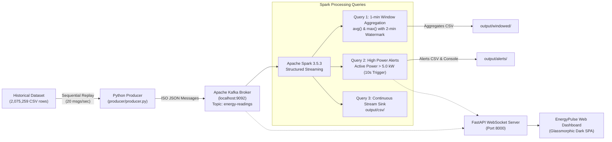

# ⚡ EnergyPulse: Real-Time Energy Monitoring & Analytics

<div align="center">

[](https://www.python.org/)
[](https://spark.apache.org/)
[](https://kafka.apache.org/)
[](https://fastapi.tiangolo.com/)
[](https://websockets.readthedocs.io/)
[](https://www.docker.com/)
[](https://microsoft.com)
[](https://pytest.org)

**A Scalable End-to-End Streaming Big Data Pipeline & Glassmorphism Web Dashboard**  
*DASSS Big Data Case Study • TE Computer Engineering • PICT Pune*

</div>

---

## 📌 Executive Summary

**EnergyPulse** is a distributed big-data streaming pipeline that replays the historical **UCI Household Electric Power Consumption** dataset (2,075,259 one-minute readings) as if it were live smart-meter telemetry.

Telemetries are published into **Apache Kafka** partitioned topics, processed in real time using **Apache Spark Structured Streaming** with event-time windowing and high-power threshold alerting, and streamed via **WebSockets** to a dark-mode **FastAPI** web dashboard.

> ⚠️ **Simulation Disclosure:**  
> All real-time telemetry is simulated by sequentially replaying the historical UCI Household Power Consumption dataset (Sète, France, 2006–2010). No physical smart-meter hardware is attached.

---

## 🏗️ Architecture & Data Flow



---

## ✨ Key Features

1. **High-Throughput Telemetry Replay:**
   - Sequential replay with exact rate reporting (~20 msgs/sec, 0.05s configurable delay).
   - ISO 8601 timestamp conversion and missing value (`?`) filtering.
2. **PySpark Structured Streaming Engine:**
   - **Query 1 (Windowed Aggregations):** 1-minute event-time windows with 2-minute watermarking computing average and peak active power.
   - **Query 2 (High-Power Alerts):** Deterministic rule `Global_active_power > 5.0 kW` triggering instant console alerts and CSV sinks.
   - **Query 3 (CSV Sink):** Checkpointed continuous stream sink into `output/csv/`.
   - *Deterministic Logic Guarantee:* Threshold logic is strictly deterministic rule-based (NOT machine learning).
3. **EnergyPulse Modern Web Dashboard:**
   - **Live Monitor:** Dynamic real-time active power chart (Chart.js), live metric cards (Active Power, Reactive Power, Voltage, Current, kWh/min, INR ₹ cost rate at ₹7.50/kWh, Sub-metering Zone 1/2/3).
   - **Historical Analytics:** Big data aggregate KPIs over all 2,075,259 readings (Peak: 11.122 kW, Avg: 1.091 kW, Total: ~4.6M kWh) with 24h diurnal profiles, daily trends, and a 24h × 7d load heatmap.
   - **Classification & Forecast:** Honest, rule-based load-level bands and moving-average projections with transparent labeling.
   - **Alerts Feed:** Instantaneous high-power incident log with audible visual cues.
   - **Export & Reports:** Instant CSV audit export and printable report layout.

---

## 📂 Project Structure

```
├── .env.example              # Environment variables template
├── .gitignore                # Git ignore patterns
├── ASSUMPTIONS.md            # Technical assumptions and architectural decisions
├── PLAN.md                   # Project implementation roadmap
├── README.md                 # Complete system documentation
├── config.yaml               # System parameters (Kafka, Spark, Dashboard, Tariff)
├── docker-compose.yml        # Confluent Kafka & Zookeeper orchestration
├── requirements.txt          # Pinned Python dependencies
├── pytest.ini                # Pytest configuration
├── data/                     # UCI Household Power Consumption dataset
│   └── .gitkeep
├── producer/
│   ├── __init__.py
│   ├── parser.py             # CSV row parser, missing value handler, ISO timestamp
│   └── producer.py           # Historical replay Kafka producer
├── spark/
│   ├── __init__.py
│   └── streaming_job.py      # PySpark 3.5.3 Structured Streaming job (3 queries)
├── dashboard/
│   ├── server.py             # FastAPI backend with WebSockets & REST APIs
│   └── static/
│       ├── index.html        # Single-page dashboard markup
│       ├── style.css         # Glassmorphism dark theme styling
│       └── app.js            # Real-time WebSocket consumer & Chart.js renderer
├── scripts/
│   ├── setup.ps1             # Virtualenv creation and pip install
│   ├── download_data.ps1     # UCI dataset downloader with fallback
│   ├── download_data.py      # Python download & synthetic fallback script
│   ├── start_kafka.ps1       # Docker Compose Kafka launcher
│   ├── run_producer.ps1      # Producer execution script
│   ├── run_spark.ps1         # PySpark streaming job runner
│   ├── run_dashboard.ps1     # Dashboard server launcher
│   ├── run_all.ps1           # Launches all services in separate PowerShell windows
│   └── stop_all.ps1          # Graceful termination of all processes
├── tests/
│   ├── test_parser.py        # Unit tests for row parsing & missing data
│   ├── test_producer.py      # Unit tests for message serialization
│   ├── test_alerts.py        # Unit tests for deterministic alert threshold
│   └── test_smoke.py         # 2,000-record end-to-end integration smoke test
└── docs/
    └── REPORT.md             # Academic case study report (DASSS PICT)
```

---

## 🚀 Quick Start Guide (Windows PowerShell)

### 1. Prerequisites
- **Windows 10 / 11** with PowerShell.
- **Python 3.10+** (Python 3.12 verified).
- **Java 11, 17, or 21** (`java -version`).
- **Docker Desktop** (for Kafka and Zookeeper).

### 2. Environment Setup
Clone the repository and run the setup script:
```powershell
# Run the automated setup script (creates .venv and installs dependencies)
.\scripts\setup.ps1
```

### 3. Obtain Dataset
Download the official UCI dataset (with automatic high-fidelity fallback generator if offline):
```powershell
.\scripts\download_data.ps1
```

### 4. Run Automated Test Suite
Verify all unit tests and the 2,000-record smoke test:
```powershell
.\.venv\Scripts\pytest.exe tests -v
```

### 5. Start Kafka Broker
Ensure Docker Desktop is running, then launch the broker:
```powershell
.\scripts\start_kafka.ps1
```
*Broker will be reachable at `localhost:9092` with topic `energy-readings` auto-configured (3 partitions).*

### 6. Run the Full System
You can launch all components at once in separate windows:
```powershell
.\scripts\run_all.ps1
```
Or run each component individually:

```powershell
# Window 1: EnergyPulse Dashboard
.\scripts\run_dashboard.ps1

# Window 2: Spark Structured Streaming
.\scripts\run_spark.ps1

# Window 3: Historical Replay Producer (e.g. 2,000 records or continuous)
.\scripts\run_producer.ps1 -Limit 2000 -Delay 0.05
```

### 7. Access the Web Dashboard
Open your browser and navigate to:  
👉 **`http://127.0.0.1:8000/`**

---

## 📊 Expected Console Output

### Producer Replay (`producer/producer.py`)
```
Connected to Kafka at localhost:9092
Starting historical replay...
Sent: 2000 records | Skipped: 0
Current Rate: ~19.5 msgs/sec
Status: Active Streaming...
```

### Spark Structured Streaming (`spark/streaming_job.py`)
```
================================================================================
 EnergyPulse Spark Structured Streaming Job (PySpark 3.5.3)
 Kafka Source    : localhost:9092 [Topic: energy-readings]
 Window Spec     : 1 minute (Slide: 1 minute, Watermark: 2 minutes)
 Alert Threshold : 5.0 kW (DETERMINISTIC RULE-BASED, NOT ML)
 Checkpoint Root : checkpoints
================================================================================
[ACTIVE STREAMING QUERIES]
  - Query Name: windowed_aggregations | Status: Active
  - Query Name: high_power_alerts     | Status: Active
  - Query Name: continuous_csv_sink   | Status: Active

HIGH POWER ALERT: [Timestamp: 2006-12-16T17:25:00] Active Power: 5.36 kW (> 5.0 kW) | Voltage: 233.63 V | Current: 23.0 A
HIGH POWER ALERT: [Timestamp: 2006-12-16T17:26:00] Active Power: 5.374 kW (> 5.0 kW) | Voltage: 233.29 V | Current: 23.0 A
```

---

## 🛠️ Troubleshooting & Workarounds

| Issue | Root Cause | Solution |
| :--- | :--- | :--- |
| `java.io.IOException: Could not locate executable winutils.exe` | Hadoop on Windows requires native binaries. | Pre-downloaded in `tools/winutils/bin/winutils.exe`. Scripts automatically configure `HADOOP_HOME`. |
| `NoBrokersAvailable` on producer start | Kafka container still booting or Docker not running. | Verify `docker compose ps` shows `energypulse-kafka` up. Run `.\scripts\start_kafka.ps1`. |
| `Cannot connect to Docker daemon` | Docker Desktop service is stopped. | Open Docker Desktop from the Windows Start menu and wait for the green indicator. |
| Port 8000 already in use | Previous Uvicorn instance still running. | Run `.\scripts\stop_all.ps1` or pass `--port 8080` to `run_dashboard.ps1`. |

---

## 📜 References & Citations

1. **UCI Machine Learning Repository:**  
   *Individual Household Electric Power Consumption Dataset*. Georges Hébrail & Alice Bérard, EDF R&D.  
   [https://archive.ics.uci.edu/dataset/235/individual+household+electric+power+consumption](https://archive.ics.uci.edu/dataset/235/individual+household+electric+power+consumption)
2. **Apache Spark Documentation:**  
   *Structured Streaming Programming Guide (v3.5.3)*.  
   [https://spark.apache.org/docs/3.5.3/structured-streaming-programming-guide.html](https://spark.apache.org/docs/3.5.3/structured-streaming-programming-guide.html)
3. **Apache Kafka Documentation:**  
   *Kafka 3.x Documentation*.  
   [https://kafka.apache.org/documentation/](https://kafka.apache.org/documentation/)

---

<div align="center">
Developed for <b>DASSS Big Data Case Study</b> • Pune Institute of Computer Technology (PICT)
</div>
