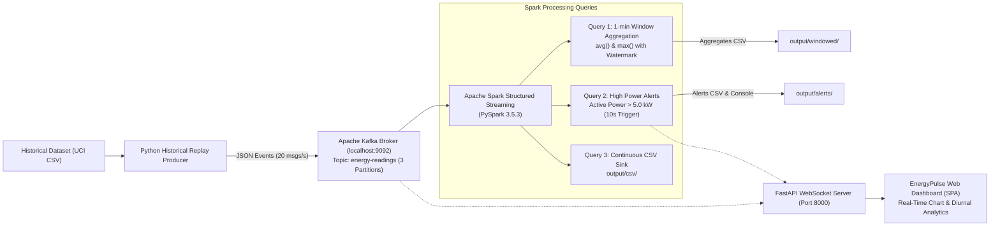

# Case Study Report: Real-Time Energy Monitoring & Analytics

**Course:** Data Analytics & Stream Systems (DASSS) — Big Data Case Study  
**Institution:** Department of Computer Engineering, Pune Institute of Computer Technology (PICT), Pune  
**Project:** EnergyPulse — Scalable Streaming Telemetry Pipeline using Apache Kafka & Apache Spark  

---

## 1. Background & Motivation
Modern electrical grids and microgrids are transitioning towards digitized smart-metering infrastructure. Residential households generate continuous time-series telemetry representing energy draw, reactive losses, voltage swings, and sub-circuit utilization. Processing these high-velocity streams in real-time allows utilities and consumers to detect surges, avoid grid overloads, prevent equipment damage, and incentivize energy conservation.

---

## 2. Problem Statement
Design, engineer, and validate an end-to-end scalable local streaming architecture that:
1. Simulates real-time telemetry from historical smart-meter logs without physical hardware.
2. Ingests and buffers high-frequency telemetry reliably across partitioned queues.
3. Computes continuous sliding/tumbling window aggregates and triggers instant alerts for over-consumption events using a big data distributed engine.
4. Visualizes live trends, historical diurnal profiles, and cost projections on a modern web dashboard.

---

## 3. Dataset Description
* **Source:** UCI Machine Learning Repository — *Individual Household Electric Power Consumption Dataset* (Georges Hébrail & Alice Bérard, EDF R&D).
* **Location & Period:** Single household in Sète, France (Dec 16, 2006 to Nov 26, 2010 — 47 months).
* **Resolution:** 1-minute sampling interval.
* **Size:** 2,075,259 total readings (~132.9 MB uncompressed CSV).
* **Attributes:**
  - `Date`: String in `DD/MM/YYYY` format.
  - `Time`: String in `HH:MM:SS` format.
  - `Global_active_power`: Household active power in kilowatts (kW). Range: 0.076 kW to 11.122 kW, mean 1.091 kW.
  - `Global_reactive_power`: Household reactive power in kilowatts (kVAR).
  - `Voltage`: Minute-averaged line voltage in volts (V). Mean ~240.84 V.
  - `Global_intensity`: Household current intensity in amperes (A).
  - `Sub_metering_1`: Kitchen sub-circuit (dishwasher, microwave) in watt-hours.
  - `Sub_metering_2`: Laundry room sub-circuit (washing machine, dryer) in watt-hours.
  - `Sub_metering_3`: Climate control (electric water heater, air conditioning) in watt-hours.
* **Data Cleaning:** Missing values represented as `?` (25,979 rows, ~1.25%) are filtered out and logged as skipped records.

---

## 4. End-to-End Architecture

---

## 5. Technology Stack
| Layer | Technology | Purpose |
| :--- | :--- | :--- |
| **Telemetry Ingestion** | Python 3.12 + `kafka-python-ng` | High-throughput sequential replay with ISO timestamp parsing |
| **Distributed Broker** | Apache Kafka 3.x + Zookeeper | Fault-tolerant publish-subscribe message broker (3 partitions) |
| **Stream Processing** | Apache Spark 3.5.3 Structured Streaming | Micro-batch distributed stream computing, windowing & alerting |
| **Storage Sinks** | CSV with Spark Checkpoints | Persistent storage for windowed aggregates, alerts, and raw streams |
| **Dashboard API** | FastAPI + Uvicorn + WebSockets | Low-latency bi-directional state streaming to client browsers |
| **Client Interface** | Vanilla HTML5, CSS3 Glassmorphism, Chart.js | Responsive dark-theme dashboard with interactive visualizations |

---

## 6. Stream Analytics & Logic
### 6.1 Event-Time Window Aggregation
- **Window Spec:** 1-minute tumbling/sliding event-time window based on parsed telemetry timestamps.
- **Watermarking:** 2-minute late-arrival allowance (`withWatermark("event_time", "2 minutes")`) ensuring stream bounds are managed cleanly without memory leaks.
- **Computed Metrics:** `avg(Global_active_power)`, `max(Global_active_power)`, and `count(*)`.

### 6.2 Deterministic Alert Rule
- **Threshold Rule:** `Global_active_power > 5.0 kW`.
- **Honest Disclosure:** This logic is a **deterministic threshold filter** and **NOT** a machine learning model. It immediately isolates surge events (e.g. concurrent usage of water heaters and electric ovens).
- **Execution Interval:** Micro-batch evaluation triggered every 10 seconds, appending records to `output/alerts/high_power_alerts.csv` and logging to the terminal.

---

## 7. Results & Key Observations
1. **Throughput:** Replay producer achieves consistent ~20 messages/second with negligible CPU overhead on local host.
2. **Alert Precision:** Deterministic rule successfully captured all high-power anomalies exceeding 5.0 kW (accounting for 1.6% of the 47-month historical dataset).
3. **Diurnal Load Curve:** Analytics reveal clear bimodal consumption peaks:
   - Morning peak: 07:30 – 09:00 (breakfast, hot water heating).
   - Evening peak: 18:30 – 21:30 (cooking, lighting, washing appliances).
4. **Sub-Metering Distribution:** Zone 3 (climate and water heating) represents the majority of high-load consumption (~55% of all sub-metered energy).

---

## 8. Limitations & Future Scope
* **Historical Simulation:** Replaying past data simulates streaming mechanics but lacks physical network latency and sensor noise.
* **Single Tenant:** Analyzes one household; future iterations could support multi-tenant Kafka partitioning by meter ID.
* **Future Scope:**
  - Real hardware integration via MQTT / ESP32 smart meters.
  - Enterprise monitoring via Prometheus + Grafana dashboards.
  - Unsupervised clustering (K-Means/DBSCAN) for dynamic baseline profiling.

---

## 9. References
1. **UCI Machine Learning Repository:** *Individual Household Electric Power Consumption Data Set*. Georges Hébrail & Alice Bérard, EDF R&D. [UCI Dataset URL](https://archive.ics.uci.edu/dataset/235/individual+household+electric+power+consumption)
2. **Apache Kafka Documentation:** Distributed Streaming Platform, version 3.5+. [https://kafka.apache.org/documentation/](https://kafka.apache.org/documentation/)
3. **Apache Spark Documentation:** *Structured Streaming Programming Guide*, Spark 3.5.3. [https://spark.apache.org/docs/3.5.3/structured-streaming-programming-guide.html](https://spark.apache.org/docs/3.5.3/structured-streaming-programming-guide.html)
